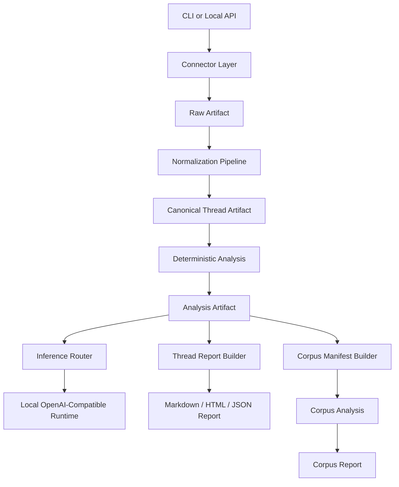

# ThreadSense System Design

## Purpose

This document describes the implemented architecture in the repository today and the main system boundaries that future changes should preserve.

## Implemented Architecture

ThreadSense is a local-first, single-process pipeline with explicit stage artifacts.



The architecture is staged, not monolithic. That is intentional. Every stage has a persisted artifact boundary.

## Major Flows

### Single-thread flow

```text
fetch -> normalize -> analyze -> optional summary -> report
```

### Reddit topic research flow

```text
subreddit search -> candidate ranking -> selected thread fetch/analyze
-> corpus manifest -> corpus analysis -> optional corpus synthesis -> corpus report
```

## Modules And Responsibilities

### Connectors

- `src/threadsense/connectors/reddit.py`
- `src/threadsense/connectors/hackernews.py`
- `src/threadsense/connectors/github_discussions.py`
- `src/threadsense/connectors/github_gist.py`

Responsibilities:

- normalize source URLs
- fetch source payloads
- validate response shape
- preserve source-specific thread metadata
- return raw artifacts for later normalization

Special notes:

- Reddit: direct thread fetch is URL-based; topic research uses explicit subreddit search with exact time-window filtering after retrieval
- GitHub Discussions: GraphQL with cursor-based pagination for comments (100/page) and replies; requires authentication token
- GitHub Gists: REST API with paginated flat comments; authentication optional for public gists; comments have no threading (all depth=0)

### Canonical Model

- `src/threadsense/models/canonical.py`
- `src/threadsense/pipeline/normalize.py`

The canonical `Thread` model is the source-agnostic internal contract.

Key properties:

- source metadata
- thread title
- thread body when available
- author metadata
- canonical comments with depth and parent links
- provenance metadata

This keeps downstream analysis source-neutral.

### Deterministic Analysis

- `src/threadsense/pipeline/analyze.py`
- `src/threadsense/pipeline/strategies/keyword_heuristic.py`

Responsibilities:

- phrase extraction
- duplicate handling
- issue/request markers
- theme grouping
- severity assignment
- evidence quote selection

### Inference Layer

- `src/threadsense/inference/contracts.py`
- `src/threadsense/inference/prompts.py`
- `src/threadsense/inference/router.py`

Responsibilities:

- task-shaped inference requests
- strict output schema validation
- required vs degraded behavior
- summary and corpus synthesis

The runtime is optional. The deterministic core still produces usable artifacts without it.

### Reporting

- `src/threadsense/reporting/build.py`
- `src/threadsense/reporting/render.py`
- `src/threadsense/reporting/corpus_render.py`
- `src/threadsense/reporting/quality.py`

Responsibilities:

- build thread reports from analysis artifacts
- generate Markdown, HTML, and JSON report outputs for thread reports
- generate Markdown corpus reports
- preserve evidence citations and run report quality checks

### Workflow Orchestration

- `src/threadsense/workflows.py`

Responsibilities:

- end-to-end single-thread runs
- report generation
- corpus manifest / analysis / report workflows
- Reddit research orchestration

## Reddit Research Design

The Reddit research workflow is implemented as discovery plus orchestration, not as a second analysis system.

### Discovery

- subreddit-scoped Reddit search
- user-facing time windows like `30d`
- coarse Reddit search bucket mapping such as `month`
- exact `created_utc` filtering after retrieval

### Query handling

Supported:

- `OR`
- `|`

Implementation detail:

- `A OR B` is executed as a union of clause searches
- local deterministic matching filters and ranks results afterward

Unsupported advanced syntax is rejected explicitly because local deterministic matching does not implement full Reddit search semantics.

### Selection

Candidate ranking uses deterministic signals:

- title phrase hits
- title term hits
- selftext phrase hits
- selftext term hits
- score
- comment count
- recency

Selection controls:

- per-subreddit cap
- global limit
- dedupe by post id

### Research Output

The research flow returns:

- selected thread metadata
- corpus manifest path
- corpus analysis path
- corpus report path
- optional corpus synthesis summary

In human mode, the CLI renders a research summary panel instead of raw JSON.

## Monitoring Design

The monitoring subsystem (`src/threadsense/monitoring/`) persists saved research profiles ("watches"), run-claim state, the durable history of bounded incremental sweeps and the digests that present new evidence. A sweep reuses the existing Reddit search, fetch, normalize and analyze stages; it does not call a model, install a schedule or deliver notifications, and the existing artifact pipeline does not depend on it.

### Profile contract

- `profiles.py` parses a TOML document with `profile_version = 1` into an immutable `WatchProfile`
- `domain`, `objective` and `abstraction_level` reuse the analysis contract enums; queries reuse the `research reddit` query validation and subreddits reuse the Reddit subreddit-name validation
- the watch `id` is a database key, not a filesystem namespace; it is validated against a pattern of lowercase letters, digits and inner hyphens, so path-like ids are rejected, and filesystem containment comes from `monitoring_dirname` resolving inside the storage root
- unknown fields, non-integer numerics, duplicates, overlapping include and exclude terms, and unsupported `profile_version` values are rejected
- queries, subreddits and terms are treated as sets and stored sorted; the content hash is the SHA-256 of canonical JSON and excludes timestamps, so equivalent documents hash identically
- the whole profile is validated before the state database is touched

### State store

- `state.py` owns a single SQLite database at `<storage root>/<monitoring_dirname>/state.sqlite3`; the path must stay inside the storage root
- schema version `1` holds `watches`, `watch_revisions` and `watch_runs`; revisions are append-only
- schema version `2` adds the sweep tables `watch_threads`, `watch_discoveries`, `watch_acquisitions`, `watch_fetch_failures`, `watch_comments`, `watch_comment_texts`, `watch_thread_revisions`, `watch_revision_analyses` and `watch_sweeps`
- schema version `3` adds `watch_digests` and `watch_digest_entries`
- saving identical content returns `unchanged` without writing; a changed profile appends a revision and returns `revised`
- the database carries an application id and a schema version; a version `1` or `2` database is upgraded in place by the first writing command, inside one transaction that only creates the missing tables and keeps every existing row, while read-only commands read it without modification and report an empty digest summary; newer-schema, foreign and non-SQLite files are refused and never migrated or downgraded
- an existing file is probed through a read-only handle before any writable connection is opened, so a refused file is never opened for writing
- a hot rollback journal left by a crashed writer is rolled back by SQLite only after a private copy of the database and journal recovers to a verified supported state with the same bytes; newer-schema, foreign and non-SQLite files and their journals are refused unchanged, and recovery that cannot complete reports `recovery_failed` or, when the files change underneath it, `recovery_conflict`
- `watch list` and `watch inspect` never create a missing database and write nothing, except for the verified hot-journal rollback above
- writes run in `BEGIN IMMEDIATE` transactions with a bounded busy timeout; a database still locked by another process after that timeout fails as `state_locked`, for reads and writes alike, and other SQLite failures surface as `monitoring_state_error` rather than raw exceptions

### Run claims, leases and fencing

- at most one run per watch is `running`, enforced inside the claim transaction and by a partial unique index on `watch_runs`
- a claim returns an owner token to the caller; only its SHA-256 is stored
- a claim carries a lease of 1-86400 seconds; a competing claim while the lease is live fails with `run_claim_error` (`claim_held`)
- the first claim after expiry marks the old run `abandoned` and records `recovered_by_run_id` on it
- finalizing requires the matching owner token and an unexpired lease; an abandoned run's old owner is refused as `stale_owner`, and an owner whose lease has expired is refused as `lease_expired`
- every sweep write repeats the owner-token and lease check inside its own transaction, so a sweep whose claim was recovered by another run cannot record observations or an outcome
- `watch run` and `watch digest` claim a run through these primitives, a sweep and
  a digest each holding their own claim; a second invocation while a claim is
  live is refused as `claim_held`; leases remain finite and unrenewed, so a run
  that outlasts its lease can be recovered by the next invocation, after which
  the overtaken run cannot record state or publish digest artifacts

### Sweeps

`sweep.py` runs one bounded sweep of a watch with `run_watch_sweep`. Each stage has its own budget from the profile `limits`, and no stage consumes another stage's budget:

- discovery searches every profile query across its subreddits (sort `new`, time window `30d`), merges and deduplicates hits by post id, caps them at `discovered_candidates`, and records every capped hit with its rank and whether it was selected; a hit that fails the existing lexical query match is rejected as `query_mismatch` and a hit containing an exclude term as `excluded_term`; include terms are recorded as preferences and do not filter; a thread once selected stays tracked
- refresh fetches at most `refreshed_threads` tracked threads in first-in, first-out order of their last attempt (a never-attempted thread queues by its discovery time), whether or not the current search returned them, so new comments on older tracked threads are still found and every tracked thread waits at most `ceil(tracked / refreshed_threads)` sweeps; a failed fetch moves the thread to the back of the queue without marking it refreshed
- search hits whose post id is not a plain Reddit id are skipped and counted, never used in a path
- analysis runs the deterministic analyzer on at most `analyzed_revisions` pending revisions, oldest first, with the model runtime and artifact versioning disabled; a revision superseded before it was analyzed is skipped because the newer snapshot contains its comments
- sweeps always fetch with the fetch cache disabled, so a cached response is never mistaken for a fresh observation of an unchanged thread
- every stage reports its limit, what it did and what is still pending; Reddit search is never treated as exhaustive (`search_completeness` is `unknown`)

Novelty comes from durable per-comment history, not from comparing the latest two fetches:

- each comment is tracked by its source id, the SHA-256 of its text and the store-clock time it was first observed
- each acquisition's observation time is read from the store clock before the fetch starts
- a comment first seen on the thread's first acquisition is an `initial_observation`; a later new comment created after the novelty cutoff is a `new_source_event`; one created before it is `newly_observed_historical`, evidence that existed but was not seen before
- the novelty cutoff is the observation time of the thread's latest acquisition that was not `truncated`, or of its first acquisition when every acquisition was truncated, so a truncated fetch never hides a new comment's arrival time
- a changed text hash is `edited`; its observation time is recorded and its source edit time stays unknown
- score, order, author, permalink and retrieval-time changes are not substantive; a known comment missing from an acquisition is recorded as absent, never as deleted, and reappearing with the same text changes nothing
- an acquisition whose payload still contains unexpanded `more` placeholders is recorded as `truncated`; otherwise completeness is `unknown`, never `complete`

A substantive change (new comment, edited comment, changed thread title or body, or the first acquisition of a thread) creates an immutable revision. Its snapshot is a canonical thread containing every known comment, including ones absent from the latest acquisition. Revision ids chain the previous revision id with the substantive content hash, so a retried transition reuses its id and an edit that later reverts still gets a new revision.

Files are written before the database references them:

- raw acquisitions, normalized acquisitions, revision snapshots and analyses are written to content-addressed or run-scoped paths with a temporary file, a file flush, an atomic rename and a directory flush, and are never overwritten
- the database row that references a file is committed only after the file exists inside the monitoring directory and its SHA-256 matches
- a crash between the file write and the database commit leaves an unreferenced file and no row; the next sweep fetches again and records the change once

A sweep ends with one outcome, recorded with its summary in the same transaction that finishes the run claim:

- `changes`: the sweep committed new revisions or analyses
- `no_changes`: every search, fetch and analysis succeeded and nothing substantive changed
- `partial`: some source work failed and some succeeded; the failures are recorded with their stage and target
- `failed`: nothing succeeded, or an error stopped the sweep

Only source failures (a failed search or fetch, an unreadable fetched payload, a fetched thread that does not match the tracked id or repeats a comment id, an analyzer refusal) are per-item failures that let the sweep continue. Malformed Reddit source structures, including non-object listing children and invalid replies, raise `RedditResponseError` at the connector/schema boundary; they are per-item source errors, not successful `no_changes`, and do not prevent remaining refresh or analysis work. A state, artifact-integrity or run-claim error stops the sweep: it is recorded as `failed` while the claim is still held, then raised. A sweep must finish within its lease; a write after the lease expired is refused as `lease_expired`.

The run claim is marked `succeeded` for `changes` and `no_changes` and `failed` otherwise, so a failed or partial fetch can never be reported as a successful `no_changes`.

### Digests

`digest.py` presents new evidence with `present_watch_digest`. It claims its own run, so `watch run` records a sweep run followed by a digest run, and a failure while the claim is live finalizes the run as `failed` and is re-raised.

Entries are created from analyzed revisions and are deterministic and idempotent:

- each analyzed revision yields one `thread_update` entry listing its novel comments, and one `finding` entry for each analysis finding whose evidence includes a novel comment; entry ids are hashes of the watch, revision and theme, and an existing id is never inserted twice
- novelty folds the comment changes of every revision since the thread's last materialized revision, so a revision superseded before analysis does not lose its novel comments; a comment first seen inside that window keeps its first-observation label even if it was also edited there. Repeated edits to an existing comment keep the pre-window previous-text hash alongside the latest content hash and latest observation time
- novel comments carry the labels `initial_observation`, `new_source_event`, `newly_observed_historical` or `edited`; an edit's source edit time is unknown and recorded as `null`
- score and order changes create no entries, and a comment missing from a truncated fetch is neither an entry nor a deletion; a `partial` or `failed` sweep is never reported as `no_changes`
- entry payloads quote the stored snapshot and analysis files after verifying their SHA-256 against the recorded values

Presentation writes artifacts before the database marks anything presented:

- a digest selects the oldest unpresented entries up to the profile `presented_findings` limit and is recorded as `pending` with its entry ids and a backlog snapshot; with nothing to present the run succeeds and no digest is created
- the JSON and Markdown files are rendered separately, only from the pending record and without reading the clock, outside their respective publication fences; after each render, a writer transaction checks the live claim and holds its fence through that file's publication, so a takeover cannot race either write; publication uses a temporary file, a file flush, an atomic rename and a directory flush, reusing identical existing bytes and refusing different bytes as `artifact_conflict`
- one fenced transaction then verifies both files and their SHA-256, marks the digest `written` and links its entries; only then are the entries presented
- a crash or lease loss between publications or before completion leaves a `pending` digest; an already published JSON file remains recoverable, and the next run completes the digest with the same id, sequence, entries and bytes, so an entry is presented at most once; this is recoverable resumption, not an exactly-once delivery guarantee, and nothing is sent to a remote destination
- the backlog reports the presentation limit, entries presented and still waiting, revisions pending analysis, tracked threads, threads pending refresh and the latest sweep outcome; `search_completeness` is always `unknown`

### Scheduling

`schedule.py` renders a launchd property list or a cron line for `watch run`. Rendering is pure: it writes no file, starts no process and installs and enables nothing, and the operator installs the output manually if they choose. The command uses absolute interpreter, workspace and storage paths, values are escaped for the target format (property list escaping for launchd; shell quoting with `%` escaped for cron), and a cron expression is produced only for intervals cron can express exactly, otherwise the render is refused. The lease equals the interval capped at 86400 seconds. Overlap is controlled by the run claim, not by the scheduler: a live claim refuses a second run, and a run outlasting its lease is fenced out of further writes once the next run recovers it. The rendered command pins the config file the render loaded, since schedulers do not inherit the shell environment.

### Boundaries

- no scheduler installation or enablement, model calls, API endpoints, remote notifications, exactly-once delivery or deletion of watches or observations
- existing JSON artifacts and their schemas are unchanged; sweep and digest artifacts live under the monitoring directory

## Artifact Boundaries

ThreadSense relies on explicit persisted artifacts.

### Raw artifact

- source-specific fetched payload

### Canonical artifact

- normalized thread

### Analysis artifact

- deterministic thread findings

### Report artifact

- thread-level rendered or structured report

### Corpus manifest

- selected analysis artifact set

### Corpus analysis

- cross-thread findings and trends

### Corpus report

- final markdown output for corpora and research runs

These boundaries are critical for replayability, inspection, and debugging.

## Output Surfaces

### JSON

- command payloads
- report artifacts
- analysis artifacts

### Human mode

- single-thread run summary panel
- Reddit research summary panel

### Quiet mode

- status-only CLI output

## API Scope

The local API is a thin wrapper around the same workflow functions used by the CLI.

Current routes focus on:

- fetch
- normalize
- analyze
- infer analysis
- report analysis

The API does not yet expose the full Reddit research workflow.

## Design Constraints

### Fail fast

Unsupported query syntax, malformed connector payloads, invalid schema versions, and inconsistent report semantics should fail explicitly.

### Deterministic first

Retrieval, normalization, candidate selection, and baseline findings remain deterministic.

### Inference portability

Inference is task-based and routed through a local OpenAI-compatible contract rather than hardcoded vendor logic.

### Source-neutral downstream analysis

Once normalized, downstream analysis and reporting do not branch on source shape.

## Current Gaps

- no non-Reddit research discovery workflow yet
- no API route for `research reddit`
- no corpus HTML report yet
- research query grammar is intentionally constrained
- sweeps and digests run only on demand or from a scheduler definition the operator installs manually; there is no daemon, remote notification or delivery tracking

These are product and workflow gaps, not evidence-layer gaps.
