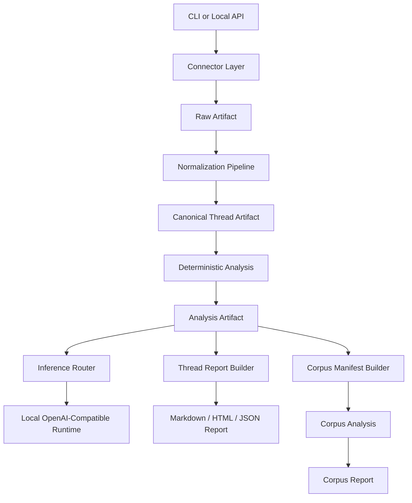

# ThreadSense System Design

## Purpose

This document describes the implemented architecture in the repository today and the main system boundaries that future changes should preserve.

## Implemented Architecture

ThreadSense is a local-first, single-process pipeline with explicit stage artifacts.



The architecture is staged, not monolithic. That is intentional. Every stage has a persisted artifact boundary.

## Major Flows

### Single-thread flow

```text
fetch -> normalize -> analyze -> optional summary -> report
```

### Reddit topic research flow

```text
subreddit search -> candidate ranking -> selected thread fetch/analyze
-> corpus manifest -> corpus analysis -> optional corpus synthesis -> corpus report
```

## Modules And Responsibilities

### Connectors

- `src/threadsense/connectors/reddit.py`
- `src/threadsense/connectors/hackernews.py`
- `src/threadsense/connectors/github_discussions.py`
- `src/threadsense/connectors/github_gist.py`

Responsibilities:

- normalize source URLs
- fetch source payloads
- validate response shape
- preserve source-specific thread metadata
- return raw artifacts for later normalization

Special notes:

- Reddit: direct thread fetch is URL-based; topic research uses explicit subreddit search with exact time-window filtering after retrieval
- GitHub Discussions: GraphQL with cursor-based pagination for comments (100/page) and replies; requires authentication token
- GitHub Gists: REST API with paginated flat comments; authentication optional for public gists; comments have no threading (all depth=0)

### Canonical Model

- `src/threadsense/models/canonical.py`
- `src/threadsense/pipeline/normalize.py`

The canonical `Thread` model is the source-agnostic internal contract.

Key properties:

- source metadata
- thread title
- thread body when available
- author metadata
- canonical comments with depth and parent links
- provenance metadata

This keeps downstream analysis source-neutral.

### Deterministic Analysis

- `src/threadsense/pipeline/analyze.py`
- `src/threadsense/pipeline/strategies/keyword_heuristic.py`

Responsibilities:

- phrase extraction
- duplicate handling
- issue/request markers
- theme grouping
- severity assignment
- evidence quote selection

### Inference Layer

- `src/threadsense/inference/contracts.py`
- `src/threadsense/inference/prompts.py`
- `src/threadsense/inference/router.py`

Responsibilities:

- task-shaped inference requests
- strict output schema validation
- required vs degraded behavior
- summary and corpus synthesis

The runtime is optional. The deterministic core still produces usable artifacts without it.

### Reporting

- `src/threadsense/reporting/build.py`
- `src/threadsense/reporting/render.py`
- `src/threadsense/reporting/corpus_render.py`
- `src/threadsense/reporting/quality.py`

Responsibilities:

- build thread reports from analysis artifacts
- generate Markdown, HTML, and JSON report outputs for thread reports
- generate Markdown corpus reports
- preserve evidence citations and run report quality checks

### Workflow Orchestration

- `src/threadsense/workflows.py`

Responsibilities:

- end-to-end single-thread runs
- report generation
- corpus manifest / analysis / report workflows
- Reddit research orchestration

## Reddit Research Design

The Reddit research workflow is implemented as discovery plus orchestration, not as a second analysis system.

### Discovery

- subreddit-scoped Reddit search
- user-facing time windows like `30d`
- coarse Reddit search bucket mapping such as `month`
- exact `created_utc` filtering after retrieval

### Query handling

Supported:

- `OR`
- `|`

Implementation detail:

- `A OR B` is executed as a union of clause searches
- local deterministic matching filters and ranks results afterward

Unsupported advanced syntax is rejected explicitly because local deterministic matching does not implement full Reddit search semantics.

### Selection

Candidate ranking uses deterministic signals:

- title phrase hits
- title term hits
- selftext phrase hits
- selftext term hits
- score
- comment count
- recency

Selection controls:

- per-subreddit cap
- global limit
- dedupe by post id

### Research Output

The research flow returns:

- selected thread metadata
- corpus manifest path
- corpus analysis path
- corpus report path
- optional corpus synthesis summary

In human mode, the CLI renders a research summary panel instead of raw JSON.

## Monitoring Design

The monitoring subsystem (`src/threadsense/monitoring/`) persists saved research profiles ("watches"), run-claim state, the durable history of bounded incremental sweeps and the digests that present new evidence. A sweep reuses the existing Reddit search, fetch, normalize and analyze stages; it does not call a model, install a schedule or deliver notifications, and the existing artifact pipeline does not depend on it.

### Profile contract

- `profiles.py` parses a TOML document with `profile_version = 1` into an immutable `WatchProfile`
- `domain`, `objective` and `abstraction_level` reuse the analysis contract enums; queries reuse the `research reddit` query validation and subreddits reuse the Reddit subreddit-name validation
- the watch `id` is a database key, not a filesystem namespace; it is validated against a pattern of lowercase letters, digits and inner hyphens, so path-like ids are rejected, and filesystem containment comes from `monitoring_dirname` resolving inside the storage root
- unknown fields, non-integer numerics, duplicates, overlapping include and exclude terms, and unsupported `profile_version` values are rejected
- queries, subreddits and terms are treated as sets and stored sorted; the content hash is the SHA-256 of canonical JSON and excludes timestamps, so equivalent documents hash identically
- the whole profile is validated before the state database is touched

### State store

- `state.py` owns a single SQLite database at `<storage root>/<monitoring_dirname>/state.sqlite3`; the path must stay inside the storage root
- schema version `1` holds `watches`, `watch_revisions` and `watch_runs`; revisions are append-only
- schema version `2` adds the sweep tables `watch_threads`, `watch_discoveries`, `watch_acquisitions`, `watch_fetch_failures`, `watch_comments`, `watch_comment_texts`, `watch_thread_revisions`, `watch_revision_analyses` and `watch_sweeps`
- schema version `3` adds `watch_digests` and `watch_digest_entries`
- schema version `4` adds the append-only issue history tables (see Issue history)
- schema version `5` adds the append-only `watch_digest_issue_views`
- schema version `6` adds the append-only operator feedback tables `watch_feedback_keys`, `watch_preference_events` and `watch_correction_events` (see Operator feedback)
- schema version `7` adds the append-only ranking tables `watch_ranking_policies`, `watch_ranking_selections` and `watch_digest_rankings` (see Ranking)
- schema version `8` adds durable comparable-window alert cohorts, windows, frozen reports, events, seen-evidence identities and completion records (see Comparable evidence alerts)
- saving identical content returns `unchanged` without writing; a changed profile appends a revision and returns `revised`
- the database carries an application id and a schema version; a supported older database is upgraded in place by the first writing command, inside one transaction that only creates missing tables and keeps every existing row, while read-only commands read it without modification, reporting an empty digest summary below version `3`, no issues below version `4`, no feedback below version `6` and unranked digests below version `7`; newer-schema, foreign and non-SQLite files are refused and never migrated or downgraded
- an existing file is probed through a read-only handle before any writable connection is opened, so a refused file is never opened for writing
- a hot rollback journal left by a crashed writer is rolled back by SQLite only after a private copy of the database and journal recovers to a verified supported state with the same bytes; newer-schema, foreign and non-SQLite files and their journals are refused unchanged, and recovery that cannot complete reports `recovery_failed` or, when the files change underneath it, `recovery_conflict`
- `watch list` and `watch inspect` never create a missing database and write nothing, except for the verified hot-journal rollback above
- writes run in `BEGIN IMMEDIATE` transactions with a bounded busy timeout; a database still locked by another process after that timeout fails as `state_locked`, for reads and writes alike, and other SQLite failures surface as `monitoring_state_error` rather than raw exceptions

### Alert producer state and resource contract

- schema version `9` adds empty indexed versioned source capture, bounded keyset legacy bootstrap, immutable alert targets/checkpoints, exact indexed identities and schema-2 publication state; migration installs capture before resumable import and never scans/backfills lifetime history
- schema version `10` adds empty watch-scoped reusable entry/evidence/occurrence/dependency and acquisition-contribution projections, immutable presence/terminal coverage bindings and explicit legacy-position lookup indexes; it replaces future-capture triggers without rewriting existing observations or historical artifacts

Alert derivation freezes the target, source commit high-water and semantic basis. An indexed canonical input expansion must establish complete report/text presence and minimum origins before any copy-sensitive event reservation. Bounded late-origin or metadata corrections append provenance overlays and revisit affected keys; no old artifact or evidence row is rewritten. Source-position continuation is separate from observation-time ordering, so tied timestamps and later lower-key/older inserts remain visible.

Schema-2 evidence is watch-cumulative; changes are target-local. Each bounded manifest inherits one immutable prior head and directly referenced segments. Readers validate decreasing generations, identities and hashes under admission, then continue rather than recursively loading a whole chain. Staged publication and immutable checkpoints bind durable bytes and global event IDs atomically before cursor/seen advancement. Expired or recovered owners cannot commit; orphan immutable files are not delivery. Oversized legacy/source objects refuse before payload reads instead of being truncated, streamed beyond the envelope or bypassed.

The CLI and typed reader have separate continuation protocols. Fresh `watch alerts` invocations resume database-stored work identified by `continuation.watch_id`, `target_id` and `command: "watch alerts"`; there is no CLI cursor. Older pending targets take priority. The journey verifies frozen target sweep/high-water/basis and checkpoint progress until the requested sweep completes, rather than accepting an older target's completion. `resource_refused` exposes unit/reason/required/configured, and unchanged retries fail visibly without automatic budget increases.

`read_alert_page` supports both schema-1 and schema-2 evidence and change collections. Each call with `budget=None` creates a fresh default finite budget; the exact returned cursor is passed unchanged with the same root/report/collection. Page receipts remain raw while items accumulate separately. Accounting limits/used, status/completion, bindings and final aggregate counts must reconcile. An empty backlog page requires durable cursor movement. Only accessed references and raw leaves are admitted and hash-verified, not all historical files eagerly.

Reusable working facts are fenced to one pending target and an expected completed coverage head. Gathering uses indexed own-watch source deltas, followed by bounded new/affected/deferred expansion and correction work; it does not clone or rescan lifetime history for each target. Canonical occurrence selection prefers eligible entries and retains intrinsic lineage independently of effective copy classification. A complete immutable presence certificate precedes copy-sensitive publication. An admitted immutable terminal checkpoint exists even for zero-derivation work; completion, counts, artifact heads, completed coverage and pending clear commit together. Cumulative published evidence, target events and versioned selected-sweep acquisition contributions have independent idempotent ownership.

Legacy capture retains its physical device/inode/schema-cookie audit tuple until both primary-key capture families and explicit ordering finish. The writer-fenced seal checks exact capture completion and indexed absence of unpositioned input. Sealed readers use immutable explicit positions, validating selected report/watch/source/predecessor identities under admission rather than using current physical rowids as progress. Future schema-1 insertion allocates its explicit position and predecessor in the source transaction. Each alert operation pins one actual tuple through phase changes, publication, nested report completion and fence exit; only a separate operation after sealing can accept a changed physical tuple. The persisted audit tuple and all old artifacts remain unchanged.

### Run claims, leases and fencing

- at most one run per watch is `running`, enforced inside the claim transaction and by a partial unique index on `watch_runs`
- a claim returns an owner token to the caller; only its SHA-256 is stored
- a claim carries a lease of 1-86400 seconds; a competing claim while the lease is live fails with `run_claim_error` (`claim_held`)
- the first claim after expiry marks the old run `abandoned` and records `recovered_by_run_id` on it
- finalizing requires the matching owner token and an unexpired lease; an abandoned run's old owner is refused as `stale_owner`, and an owner whose lease has expired is refused as `lease_expired`
- every sweep write repeats the owner-token and lease check inside its own transaction, so a sweep whose claim was recovered by another run cannot record observations or an outcome
- `watch run`, `watch digest` and `watch alerts` claim runs through these primitives; sweep, digest and alert presentation each hold their own claim. A second invocation while a claim is live is refused as `claim_held`; leases remain finite and unrenewed, so a run that outlasts its lease can be recovered by the next invocation, after which the overtaken run cannot record state or publish artifacts

### Sweeps

`sweep.py` runs one bounded sweep of a watch with `run_watch_sweep`. Each stage has its own budget from the profile `limits`, and no stage consumes another stage's budget:

- discovery searches every profile query across its subreddits (sort `new`, time window `30d`), merges and deduplicates hits by post id, caps them at `discovered_candidates`, and records every capped hit with its rank and whether it was selected; a hit that fails the existing lexical query match is rejected as `query_mismatch` and a hit containing an exclude term as `excluded_term`; include terms are recorded as preferences and do not filter; a thread once selected stays tracked
- refresh fetches at most `refreshed_threads` tracked threads in first-in, first-out order of their last attempt (a never-attempted thread queues by its discovery time), whether or not the current search returned them, so new comments on older tracked threads are still found and every tracked thread waits at most `ceil(tracked / refreshed_threads)` sweeps; a failed fetch moves the thread to the back of the queue without marking it refreshed
- search hits whose post id is not a plain Reddit id are skipped and counted, never used in a path
- analysis runs the deterministic analyzer on at most `analyzed_revisions` pending revisions, oldest first, with the model runtime and artifact versioning disabled; a revision superseded before it was analyzed is skipped because the newer snapshot contains its comments
- sweeps always fetch with the fetch cache disabled, so a cached response is never mistaken for a fresh observation of an unchanged thread
- every stage reports its limit, what it did and what is still pending; Reddit search is never treated as exhaustive (`search_completeness` is `unknown`)

Novelty comes from durable per-comment history, not from comparing the latest two fetches:

- each comment is tracked by its source id, the SHA-256 of its text and the store-clock time it was first observed
- each acquisition's observation time is read from the store clock before the fetch starts
- a comment first seen on the thread's first acquisition is an `initial_observation`; a later new comment created after the novelty cutoff is a `new_source_event`; one created before it is `newly_observed_historical`, evidence that existed but was not seen before
- the novelty cutoff is the observation time of the thread's latest acquisition that was not `truncated`, or of its first acquisition when every acquisition was truncated, so a truncated fetch never hides a new comment's arrival time
- a changed text hash is `edited`; its observation time is recorded and its source edit time stays unknown
- score, order, author, permalink and retrieval-time changes are not substantive; a known comment missing from an acquisition is recorded as absent, never as deleted, and reappearing with the same text changes nothing
- an acquisition whose payload still contains unexpanded `more` placeholders is recorded as `truncated`; otherwise completeness is `unknown`, never `complete`

A substantive change (new comment, edited comment, changed thread title or body, or the first acquisition of a thread) creates an immutable revision. Its snapshot is a canonical thread containing every known comment, including ones absent from the latest acquisition. Revision ids chain the previous revision id with the substantive content hash, so a retried transition reuses its id and an edit that later reverts still gets a new revision.

Files are written before the database references them:

- raw acquisitions, normalized acquisitions, revision snapshots and analyses are written to content-addressed or run-scoped paths with a temporary file, a file flush, an atomic rename and a directory flush, and are never overwritten
- the database row that references a file is committed only after the file exists inside the monitoring directory and its SHA-256 matches
- a crash between the file write and the database commit leaves an unreferenced file and no row; the next sweep fetches again and records the change once

A sweep ends with one outcome, recorded with its summary in the same transaction that finishes the run claim:

- `changes`: the sweep committed new revisions or analyses
- `no_changes`: every search, fetch and analysis succeeded and nothing substantive changed
- `partial`: some source work failed and some succeeded; the failures are recorded with their stage and target
- `failed`: nothing succeeded, or an error stopped the sweep

Only source failures (a failed search or fetch, an unreadable fetched payload, a fetched thread that does not match the tracked id or repeats a comment id, an analyzer refusal) are per-item failures that let the sweep continue. Malformed Reddit source structures, including non-object listing children and invalid replies, raise `RedditResponseError` at the connector/schema boundary; they are per-item source errors, not successful `no_changes`, and do not prevent remaining refresh or analysis work. A state, artifact-integrity or run-claim error stops the sweep: it is recorded as `failed` while the claim is still held, then raised. A sweep must finish within its lease; a write after the lease expired is refused as `lease_expired`.

The run claim is marked `succeeded` for `changes` and `no_changes` and `failed` otherwise, so a failed or partial fetch can never be reported as a successful `no_changes`.

### Digests

`digest.py` presents new evidence with `present_watch_digest`. It claims its own run, so `watch run` records a sweep run followed by a digest run, and a failure while the claim is live finalizes the run as `failed` and is re-raised.

Entries are created from analyzed revisions and are deterministic and idempotent:

- each analyzed revision yields one `thread_update` entry listing its novel comments, and one `finding` entry for each analysis finding whose evidence includes a novel comment; entry ids are hashes of the watch, revision and theme, and an existing id is never inserted twice
- novelty folds the comment changes of every revision since the thread's last materialized revision, so a revision superseded before analysis does not lose its novel comments; a comment first seen inside that window keeps its first-observation label even if it was also edited there. Repeated edits to an existing comment keep the pre-window previous-text hash alongside the latest content hash and latest observation time
- novel comments carry the labels `initial_observation`, `new_source_event`, `newly_observed_historical` or `edited`; an edit's source edit time is unknown and recorded as `null`
- score and order changes create no entries, and a comment missing from a truncated fetch is neither an entry nor a deletion; a `partial` or `failed` sweep is never reported as `no_changes`
- entry payloads quote the stored snapshot and analysis files after verifying their SHA-256 against the recorded values

Presentation writes artifacts before the database marks anything presented:

- a digest selects the oldest unpresented entries up to the profile `presented_findings` limit and is recorded as `pending` with its entry ids and a backlog snapshot; with nothing to present the run succeeds and no digest is created
- the JSON and Markdown files are rendered separately, only from the pending record and without reading the clock, outside their respective publication fences; after each render, a writer transaction checks the live claim and holds its fence through that file's publication, so a takeover cannot race either write; publication uses a temporary file, a file flush, an atomic rename and a directory flush, reusing identical existing bytes and refusing different bytes as `artifact_conflict`
- one fenced transaction then verifies both files and their SHA-256, marks the digest `written` and links its entries; only then are the entries presented
- a crash or lease loss between publications or before completion leaves a `pending` digest; an already published JSON file remains recoverable, and the next run completes the digest with the same id, sequence, entries and bytes, so an entry is presented at most once; this is recoverable resumption, not an exactly-once delivery guarantee, and nothing is sent to a remote destination
- the backlog reports the presentation limit, entries presented and still waiting, revisions pending analysis, tracked threads, threads pending refresh and the latest sweep outcome; `search_completeness` is always `unknown`
- issue evidence is recorded after entries are materialized and before a digest is created; a new digest records its issue view (the referenced issues, entry evidence and updates as of presentation) in the same transaction as the digest, so a resumed digest renders the same bytes, and the artifact is schema `2` when a view exists; a digest that also records a ranking basis renders schema `3` with a `ranking` section and presents its entries in ranked order (see Ranking)

### Comparable evidence alerts

`alerts.py` exposes `present_watch_alerts`; `alert_records.py` records comparison cohorts, windows, frozen reports, events, seen-evidence identities and completion hashes through `MonitoringStore`. State schema `8` adds the alert tables without rewriting existing evidence or digests. `watch run` and `watch digest` present alerts after digest ingestion; `watch alerts` performs presentation only, with no source fetch, deterministic reanalysis or model inference.

The latest durable sweep identifies a comparison window. The first window establishes a baseline; changing the comparable profile/source/query/limits/sampling or collection-policy basis establishes a new baseline instead of increased demand. Reports bind actual saved sweep collection settings, profile revision/content hash, issue policy, ranking/feedback basis and prior baseline references. No new sweep means reuse of the same report ids and bytes, not retroactive substitution of current invocation configuration.

Evidence identity, rather than score or retrieval time, drives stable alert ids. Durable seen-evidence state suppresses unchanged text, score-only changes and disappearance/reappearance across process restarts and cohort baselines. Cited events distinguish new evidence, edits, new observed communities and lexical reproduction/contradiction/workaround/resolution claims. Copies do not corroborate; accounts and communities never establish independent people, and a claim never verifies reproduction or resolves an issue.

Coverage and bounded candidate/comment denominators describe only the observed sample. Unknown, truncated or partial collection refuses rate/trend inference while retaining honest cited additions. Source comment creation, source thread creation when available, first observation and edit observation are separate; source edit time stays unknown, and an earliest-comment corpus proxy is not thread creation.

Alert publication uses its own exclusive finite run claim and per-file fencing. Frozen pending reports survive interruption, resume the same identities/bytes, verify cited artifact hashes and refuse conflicting existing bytes rather than overwrite them. The result separates a report's fixed `alert_ids` from `new_alert_ids` newly committed in that invocation; this is durable local presentation, not notification delivery. Exact fields and paths are in [Comparable Evidence Alerts](artifacts.md#comparable-evidence-alerts).

`new_alert_ids` may be nonempty during backlog. The integrated journey keeps a distinct accumulation receipt with invocation, target and report provenance, without mutating any raw result or immutable report. Replay checks use schema-2 global IDs in `alert_v2_event_identities` as well as preserved legacy state; growth in legitimate `watch_alert2_*` target/checkpoint/report/completion rows is not duplicate alert delivery. The guarantee is local durable discoverability, not external exactly-once delivery.

### Operator acceptance boundary

The integrated `smoke_monitoring.py --scenario all --work-dir DIR --endpoint URL` journey uses one saved watch and monitoring database, fresh CLI subprocesses and in-process recorded Reddit transport. Its real local checkpoint annotates the actual monitoring snapshots, not unrelated evaluation fixtures. Manifest/labels/expected scope are frozen before inference; engineering labels are disclosed as non-independent. Evaluation disables optional generative inference and the policy checker must retain supported `not_eligible` shadow operation, without installing or activating policy.

Acceptance inspects durable citations, exact-copy lineage, unverified claims, separate preference/correction events, historical/current ranking explanations, digest/alert suppression, process restart, interrupted publication under live fencing, coverage refusals, cohort reset and render-only cron/launchd definitions. `all-evidence.json` and command/artifact receipts are engineering behavior evidence, not accuracy or promotion claims. Deterministic alerts do not depend on semantic eligibility. See the [operator journey and failures/recovery guide](usage.md#continuous-operator-journey) for the command and remediation boundaries.

Journey-local orchestration explicitly completes bounded CLI work and separately traverses complete target changes and watch-cumulative evidence using fresh default finite reader budgets. Raw command payloads/stdout/stderr and per-page receipts are distinct from accumulated IDs/items. These helpers do not change public commands, reader cursors, product reports, frozen labels/tolerances or model outputs.

### Issue history

Issue history (`issue_records.py`, `issue_lineage.py`, `issue_views.py`, `issues.py`) records which watch threads report the same problem, without inferring more than the evidence supports. Ingestion reads finding entries and the verified snapshot and analysis files they cite; it calls no model.

- **Identity.** An issue is identified by its home thread: its id is derived from the watch and thread, and the issue is created the first time that thread's finding evidence is recorded. A report is one source comment cited as finding evidence. Evidence from one thread stays with that thread.
- **Lineage.** A report's recorded lineage is fixed when first recorded. It is an `exact_copy` when its whitespace-collapsed text has at least 40 characters and its hash equals that of an earlier firsthand report of another comment whose origin was posted no later than the copy; otherwise it is `firsthand`. A new thread joins the issue of the report it copies only when all of its first recorded reports are exact copies; the earliest such origin wins and the basis is `exact_content_lineage`. A partial copy never groups: it appears as an `exact_copies` signal on a suggestion. An exact copy records update cues only for text its origin never had.
- **Effective lineage.** Ingestion order can differ from posting order, so a repost can be recorded `firsthand` before its earlier original is ingested. When a later ingestion discovers the original, it appends a correction event to its own ingestion-ledger row (`lineage_corrections`, `lineage_events`) instead of editing the report. Effective lineage is the recorded lineage overridden by the latest event; inspect exposes it as `lineage` and `copy_of_report_id` beside `recorded_lineage`, `recorded_copy_of_report_id` and `lineage_correction`. Firsthand and exact-copy counts follow effective lineage, update counts exclude a corrected copy's cues on the copied text, observed counts do not change, and a correction never regroups threads, so suggestions stay unconfirmed until an operator links. Stored issue views and rendered digests are never rewritten; new digests capture effective lineage.
- **Reversibility.** A thread's current issue is its latest membership event. Operator `link` and `unlink` append events with a required reason, and `unlink` returns a thread to its own home issue, so a wrong grouping, whether from lineage or from an operator, is undone by appending, never by editing. Triggers abort every update and delete of issue tables.
- **Counts.** Counts are observations over member threads: threads, communities, hashed accounts, reports, firsthand reports and exact copies. They never assert independence, which stays `not_verified`: distinct accounts or communities can be sockpuppets, cross-posts or one author. Exact copies are counted separately and never corroborate.
- **Suggestions.** Each new thread is compared once, inside one bounded query: other threads whose first evidence lies within the candidate window, nearest first, at most `max_candidate_comparisons`. Shared themes or key phrases create an `unconfirmed` suggestion, ranked by overlap then time gap and capped at `max_suggestions_per_thread` (`suggestions_truncated` counts qualifying candidates beyond the cap). A shared link with no shared theme or phrase is recorded as `refused` with `shared_link_only`, because a common URL, such as a status page, is not evidence of one issue. Suggestions never change memberships or counts, and the digest marks semantic grouping `not_eligible`.
- **Update cues.** A fixed list of lexical cues per kind (`reproduction`, `contradiction`, `workaround`, `resolution_claim`) is matched on word boundaries. A match records an unverified claim citing its cue, never a fact. A resolution claim never resolves an issue: issue status is always `open` and `resolution.resolved` is `false`.
- **Refusals.** Link and unlink refuse and write nothing for `invalid_issue_request`, `unknown_watch`, `unknown_issue`, `unknown_issue_thread`, `already_member`, `inactive_issue`, `issue_has_other_members`, `not_member` and `not_linked`.

### Operator feedback

Operator feedback (`feedback_records.py`, exposed as `feedback record` and `feedback list`) keeps subjective preferences apart from correction assertions. Neither kind edits evidence, findings, counts, issue membership or any written digest or report.

- **Tables.** Schema version `6` adds three tables without touching existing ones: `watch_feedback_keys` holds one row per watch-scoped idempotency key, and `watch_preference_events` and `watch_correction_events` hold the two kinds separately, each with its own per-watch sequence. Triggers abort every update and delete, so all three are append-only.
- **Idempotency.** The feedback id is `fbk-` followed by the first 32 hex characters of the SHA-256 of the watch id and key. The key row stores the kind and the SHA-256 of the canonical request content (kind, value, target kind, target id and stripped note). A repeated key with the same kind and content hash returns the stored event as `unchanged`; any difference is refused as `idempotency_conflict`. Both kinds share the namespace, so one key never names both a preference and a correction.
- **Target resolution.** Requests are validated before the database is touched (`invalid_feedback_request`, `value_kind_mismatch`, `target_kind_mismatch` for an id that does not name the kind). Inside the write transaction the target is resolved against the watch's digest entries, thread revisions or issues; a missing target is refused as `unknown_target`, one owned by another watch as `cross_watch_target`, and a `finding` target that is not a finding entry as `target_kind_mismatch`, all before anything is written.
- **Preference scopes.** Each preference event records the scope it applies to: `entry` (one digest entry), `finding` (the finding stream of one thread and theme, keyed `<thread id>/<theme key>`, so it spans revisions), `thread` (an observation target, scoping the whole thread) or `issue`. The effective preference for a scope is its latest event by sequence; earlier events in that scope are kept and reported as superseded. Preferences are presentation signals only: digest selection never reads them, and the ranking of digests recorded afterwards does (see Ranking).
- **Correction view.** Corrections are grouped by target into a derived view beside the original target facts read from the unchanged stored records (an entry's kind, thread, revision, theme, severity and payload SHA-256; a revision's thread, sequence and content hashes; an issue's home thread). The view lists the assertions with their notes and reports `effect: "assertion_only"`. Corrections are auditable operator claims, never truth labels or training data.
- **Reads.** `feedback list` reads through a read-only connection and never writes; a database below schema version `6` reports empty histories.

### Ranking

Ranking (`ranking.py`, `ranking_records.py`, `explain.py`, exposed as `watch policy` and `watch explain`) orders the entries one digest presents. It never selects, hides, drops, rewrites or counts evidence: selection is unchanged, so a digest still takes the oldest unpresented entries up to the profile limit, and only their presentation order changes.

- **Baseline.** The existing deterministic finding order breaks every score tie: findings before thread updates, then higher severity, more issue markers, more request markers, more comments, theme key and finally entry id, so the order never depends on database iteration.
- **Components.** An explicit, immutable policy assigns bounded integer points per component, each with a recorded reason. `severity` scores the finding's severity. `objective` takes the signal type (`issue`, `request`, `mixed`, `discussion`) that the existing `classify_finding_signal` derives from the finding's theme, severity, comment count and issue and request markers, read from the hash-verified analysis artifact, and weights it per profile objective. `novelty` scores the most novel kind among the entry's new comments. `evidence` counts new comments up to a cap. `preference` takes, for each scope the entry belongs to (entry, finding stream, thread and issue), the latest preference up to the recorded sequence, sums their points and clamps the sum to plus or minus the policy bound. `semantic` is always `not_eligible` with `null` points: no eligible semantic ranking policy exists and typed annotations stay shadow-only. Thread updates score `0` for severity and objective. The score is the sum of the integer points; corrections are not an input.
- **Policies.** A policy is a strict TOML document: every field is required, unknown fields are refused and every value is range-checked. Its id is `pol-` followed by the first 32 hex characters of the SHA-256 of its canonical JSON, so policies are content-addressed and immutable; a stored policy is re-validated and must still hash to its id when read. A watch without selections uses the built-in default policy.
- **Tables.** Schema version `7` adds three append-only tables without touching existing ones: `watch_ranking_policies` (one row per policy id), `watch_ranking_selections` (each watch's per-watch sequence of policy selections; the latest is active) and `watch_digest_rankings` (one basis row per digest). Triggers abort every update and delete. Selecting the already active policy appends nothing; switching back to an earlier policy appends a new selection and never rewrites a digest.
- **Basis.** `begin_digest` records the digest's ranking basis (the claim's profile revision, the active policy id and the watch's latest preference sequence) inside the same transaction that records the pending digest, its entries and its issue view, recording the policy itself if it is the default and not yet stored. The order is materialized from exactly those inputs, so a resumed pending digest renders identical bytes even when preferences, policies or the profile changed in between. Preferences and policy selections recorded afterwards affect only later digests.
- **Explain.** `watch explain` reads through a read-only connection, replays the recorded basis for the entry's digest and, for a written digest, refuses with `ranking_replay_mismatch` unless the replayed ranking equals the `ranking` stored in the hash-verified digest JSON artifact. `--current` ranks the same entries under the current basis on demand and records nothing. Digests recorded before schema version `7` have no basis and are reported as unranked in selection order.

### Scheduling

`schedule.py` renders a launchd property list or a cron line for `watch run`. Rendering is pure: it writes no file, starts no process and installs and enables nothing, and the operator installs the output manually if they choose. The command uses absolute interpreter, workspace and storage paths, values are escaped for the target format (property list escaping for launchd; shell quoting with `%` escaped for cron), and a cron expression is produced only for intervals cron can express exactly, otherwise the render is refused. The lease equals the interval capped at 86400 seconds. Overlap is controlled by the run claim, not by the scheduler: a live claim refuses a second run, and a run outlasting its lease is fenced out of further writes once the next run recovers it. The rendered command pins the config file the render loaded, since schedulers do not inherit the shell environment.

### Boundaries

- no scheduler installation or enablement, model calls, API endpoints, remote notifications, exactly-once delivery or deletion of watches or observations
- existing JSON artifacts and their schemas are unchanged; sweep and digest artifacts live under the monitoring directory

## Typed Decision Path

The typed decision path (`src/threadsense/decisions/`) is separate from the generative inference layer. Inference routes task prompts to a local OpenAI-compatible chat endpoint. The typed path uses its own client, `TypedDecisionClient`, against a different service: a pinned, operator-provisioned Laya runtime that answers fixed typed questions per comment over a batch endpoint. The two runtimes have different contracts, endpoints and enablement: see [local-runtime-contract.md](local-runtime-contract.md) for the generative one and [laya-runtime.md](laya-runtime.md) for the typed one.

- **Shadow only.** `threadsense decisions annotate` reads one canonical thread artifact and writes annotations. It never runs analysis or the generative runtime, and it does not depend on `THREADSENSE_RUNTIME_ENABLED`. Annotations are uncalibrated and never feed back into findings, ranking, discovery or reports.
- **Loopback only.** The endpoint must be a literal loopback `http` URL. Discussion content is sent only to that service.
- **Pinned identity.** A packaged manifest declares the code commit and the six checkpoint files. The client verifies the checkpoint files by SHA-256 on every invocation; the service does not expose its code identity.
- **Artifact separation.** Decision documents and run records live under their own annotation root, which is refused when it lies inside baseline or monitoring storage or aliases the input. Existing baseline and monitoring artifacts and schemas are unchanged.
- **Optional dependency.** The core install does not need torch or transformers; they exist only inside the separately provisioned service environment.
- **Eligibility gate, not activation.** `threadsense decisions policy check` is the single checker that decides whether a typed decision shape is eligible for a semantic consumer, from a saved evaluation document and an optional operator-authored policy bound to the runtime, question set, settings, context policy, language, dataset and labels. It never activates a consumer, installs a policy or changes mode. Under the real runtime it reports `not_eligible`, because the held-out labels are not independently adjudicated and no domain tolerances exist; a `test_only` policy over a disclosed constructed fixture runs the same checks and never permits activation.

Operator reference: [usage.md](usage.md#decisions-annotate). Artifact definitions: [artifacts.md](artifacts.md#typed-decision-annotations).

### Frozen assessment and generative comparison

`decisions evaluate` validates the corpus, labels and saved annotation identities, then replays recorded typed responses without contacting Laya. Count reconciliation checks structural invariants; separate corpus/annotation alignment checks establish that those counts describe the bound inputs. Neither is a quality measurement. Engineering-authored labels describe constructed boundary cases, not independent adjudication or population accuracy.

The existing generative reclassification task supports a separate paired `theme` cohort, not the other five typed dimensions. It includes thread-title context and uses the existing domain vocabulary. Only typed-eligible, supported-language comments of at most 300 characters enter this cohort, so their bodies are not truncated by the task. Typed, heuristic and generative comparisons use exactly the same thread/comment IDs and explicit denominators. Longer comments, unsupported dimensions and unavailable results remain visible rather than being scored as losses. Default or novel themes map to `other_or_uncertain` abstention.

Fresh acquisition uses the configured enabled literal-loopback chat runtime, capturing exact exchanges and model identities in an immutable content-addressed artifact bound to the corpus, annotations, labels and question set. Supplying `--generative-capture PATH` validates and replays that artifact offline without listing models or running inference. Live acquisition is not deterministic replay. Configured-model absence is an observed unavailability; disabled or invalid-endpoint guards are `not_observed`. Neither comparator availability nor replay activates a policy or changes baseline analysis. Client wall time is not model-server memory, and a point-in-time RSS observation is not peak RSS.

## Artifact Boundaries

ThreadSense relies on explicit persisted artifacts.

### Raw artifact

- source-specific fetched payload

### Canonical artifact

- normalized thread

### Analysis artifact

- deterministic thread findings

### Report artifact

- thread-level rendered or structured report

### Corpus manifest

- selected analysis artifact set

### Corpus analysis

- cross-thread findings and trends

### Corpus report

- final markdown output for corpora and research runs

These boundaries are critical for replayability, inspection, and debugging.

## Output Surfaces

### JSON

- command payloads
- report artifacts
- analysis artifacts

### Human mode

- single-thread run summary panel
- Reddit research summary panel

### Quiet mode

- status-only CLI output

## API Scope

The local API is a thin wrapper around the same workflow functions used by the CLI.

Current routes focus on:

- fetch
- normalize
- analyze
- infer analysis
- report analysis

The API does not yet expose the full Reddit research workflow.

## Design Constraints

### Fail fast

Unsupported query syntax, malformed connector payloads, invalid schema versions, and inconsistent report semantics should fail explicitly.

### Deterministic first

Retrieval, normalization, candidate selection, and baseline findings remain deterministic.

### Inference portability

Inference is task-based and routed through a local OpenAI-compatible contract rather than hardcoded vendor logic.

### Source-neutral downstream analysis

Once normalized, downstream analysis and reporting do not branch on source shape.

## Current Gaps

- no non-Reddit research discovery workflow yet
- no API route for `research reddit`
- no corpus HTML report yet
- research query grammar is intentionally constrained
- sweeps and digests run only on demand or from a scheduler definition the operator installs manually; there is no daemon, remote notification or delivery tracking
- typed decision annotations are shadow-only and uncalibrated, use an English checkpoint, and require an operator-provisioned local service

These are product and workflow gaps, not evidence-layer gaps.
